# Rapport – Projet fil rouge CI/CD SouverainRecrut

**Module** CI/CD – Mastère Expert en Développement et Déploiement de Solutions Numériques Sécurisées (M2, RNCP 40166)
**Étudiant** Mamadou Cherif Diallo
**Dépôt** https://github.com/CherifDalein/souverainrecrut (branche `Dev`)
**Image** https://hub.docker.com/r/cherifdiallo725/souverainrecrut-backend

> Partie 1 (Jour 1) – Intégration continue avec Jenkins : **réalisée**.
> Partie 2 (Jour 2) – Provisionnement et déploiement : **réalisée**, rollback testé.

---

## 1. Objectif de la partie 1

À l'issue de cette partie, l'API Backend doit être **testée, analysée, conteneurisée et publiée sur Docker Hub** par une chaîne automatisée (cahier des charges, section 3).

La démarche suit la progression du cours : **Manuel → Scripté → Automatisé**. Chaque étape a d'abord été exécutée et validée à la main (tests, analyse SonarQube, build et scan de l'image, push), puis confiée à Jenkins. Ainsi, une erreur dans le pipeline relève de la configuration de Jenkins et non d'une étape jamais vérifiée.

## 2. Architecture de la chaîne d'intégration

```
GitHub (Dev) ──pollSCM──▶ Jenkins ──▶ tests ──▶ SonarQube / Quality Gate ──▶ build Docker ──▶ Trivy ──▶ Docker Hub
```

| Composant | Rôle | Hébergement |
|---|---|---|
| GitHub | Code source, branche de travail `Dev` | fork personnel |
| Jenkins 2.580.2 | Orchestration du pipeline (`Jenkinsfile` versionné) | conteneur Docker, image personnalisée |
| SonarQube 9.9 LTS | Analyse statique, couverture, Quality Gate | conteneur Docker |
| Trivy 0.58.1 | Scan de vulnérabilités de l'image | binaire dans l'image Jenkins |
| Docker Hub | Registre des images versionnées | `cherifdiallo725/souverainrecrut-backend` |

Jenkins et SonarQube partagent le réseau Docker `ci` ; Jenkins utilise le moteur Docker de l'hôte via le socket monté. Détail de la reproduction : [`integration-continue/README.md`](../integration-continue/README.md).

## 3. Travaux réalisés

### 3.1 Préparation du dépôt
- Fork du dépôt officiel et récupération de la branche `Dev` (absente du fork, copiée depuis le dépôt amont).
- Installation : `npm ci`, `npx prisma generate`, `npm run build`.

### 3.2 Tests Backend
- **Choix** : Jest + ts-jest + Supertest. Jest produit nativement le format `lcov` lu par SonarQube ; Supertest teste l'application Express sans démarrer de serveur.
- **Isolation** : le client Prisma est remplacé par un mock (`moduleNameMapper`). Les tests s'exécutent en 2 s **sans PostgreSQL**, ce qui simplifie l'agent CI.
- **70 tests** répartis en 9 fichiers : authentification (login, JWT invalide, expiré ou forgé), contrôle d'accès (401 sans token, 403 pour un rôle insuffisant), candidats, offres, candidatures, utilisateurs (hachage bcrypt), tableau de bord, santé de l'API, gestion des erreurs.
- **Rapports** : `coverage/lcov.info` (couverture) et `coverage/test-report.xml` (exécution, via `jest-sonar`).

### 3.3 Analyse SonarQube
- Configuration dans `backend/sonar-project.properties` (sources, tests, exclusions, rapports).
- Création du Quality Gate **SouverainRecrut**, défini par défaut, avec des conditions sur le *New Code* **et** l'*Overall Code* : le gate par défaut ne contrôlait que le nouveau code et passait même avec une couverture globale faible.
- Traitement du Security Hotspot **S5689** (`X-Powered-By`) : correction dans `app.ts` et test de non-régression.

La couverture est passée de **52,5 %** à **94,4 %**. Le nombre de lignes à couvrir reste stable (504 → 503) : la hausse vient uniquement des tests ajoutés, sans modification du code applicatif.

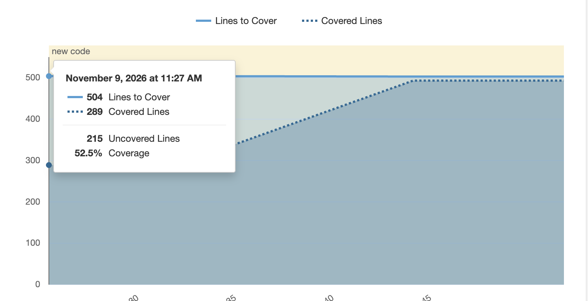
*Figure 1 – SonarQube, onglet Activity : couverture avant l'écriture des tests (289 lignes couvertes sur 504, soit 52,5 %).*

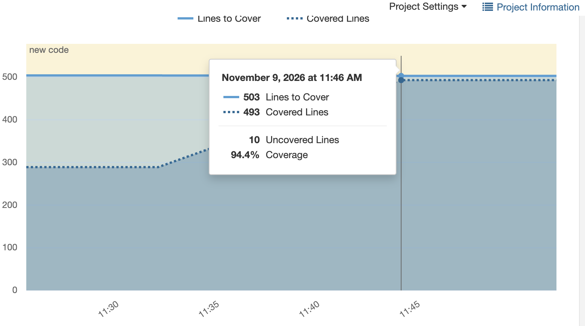
*Figure 2 – SonarQube, onglet Activity : couverture après l'écriture des tests (493 lignes couvertes sur 503, soit 94,4 %).*

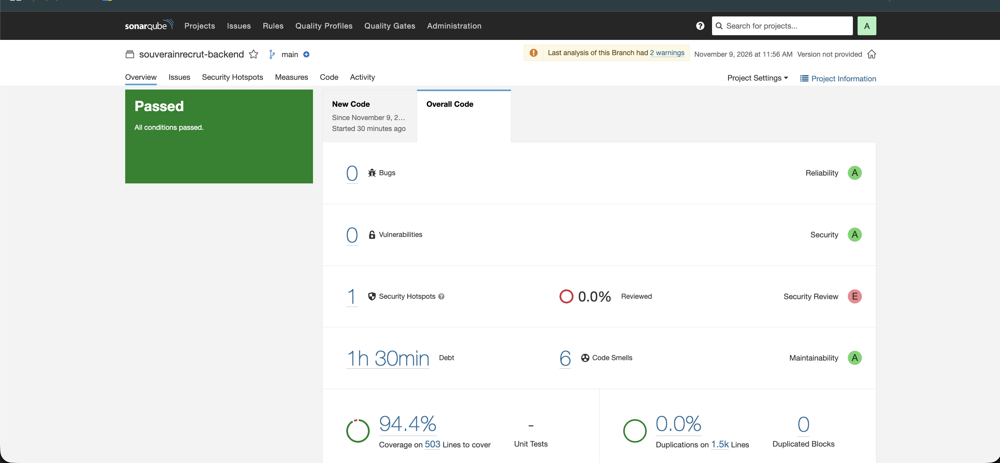
*Figure 3 – Vue Overall Code après les tests : Quality Gate Passed, 0 bug, 0 vulnérabilité, 0 % de duplication.*

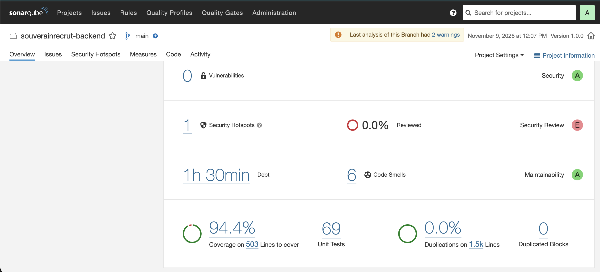
*Figure 4 – Rapport d'exécution des tests importé dans SonarQube (69 tests à ce stade) et version 1.0.0 de l'analyse.*

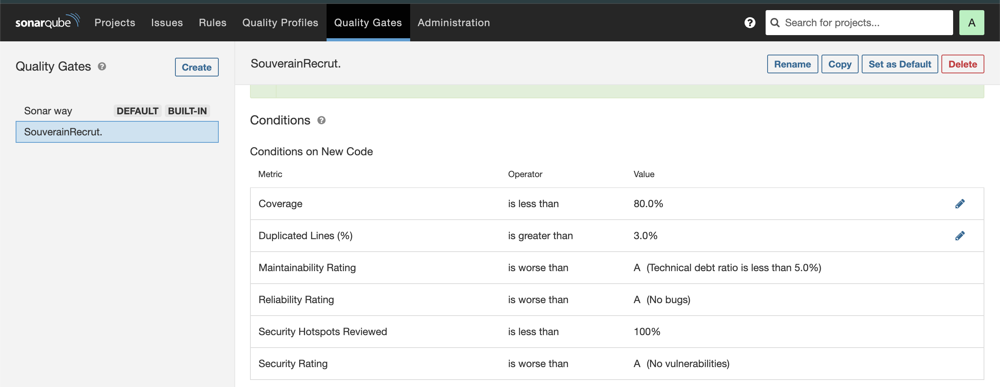
*Figure 5 – Quality Gate SouverainRecrut : couverture ≥ 80 %, duplications ≤ 3 %, notes A, 100 % des Security Hotspots revus.*

### 3.4 Mise en place de Jenkins
- Image Jenkins personnalisée ([`integration-continue/jenkins/Dockerfile`](../integration-continue/jenkins/Dockerfile)) : Node 22, client Docker + buildx, Trivy, plugins préinstallés (Git, Pipeline, SonarQube, Credentials Binding).
- `docker-compose.yml` : volume persistant `jenkins_home`, socket Docker de l'hôte, réseau `ci`.
- Credentials `dockerhub` et `sonar-token` ; serveur SonarQube et outil `sonar-scanner` déclarés ; webhook SonarQube → Jenkins.

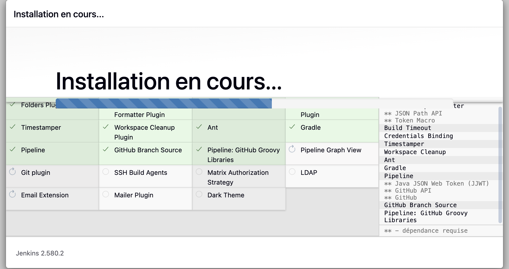
*Figure 6 – Installation des plugins Jenkins (Pipeline, Git, Credentials Binding, Timestamper…).*

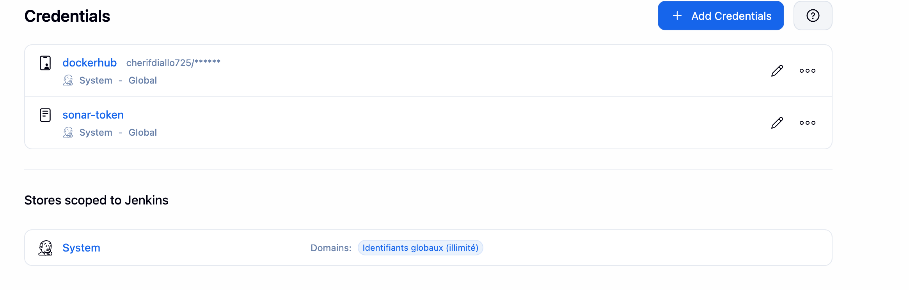
*Figure 7 – Credentials Jenkins : `dockerhub` et `sonar-token`, secrets masqués. Aucun secret n'est présent dans le dépôt.*

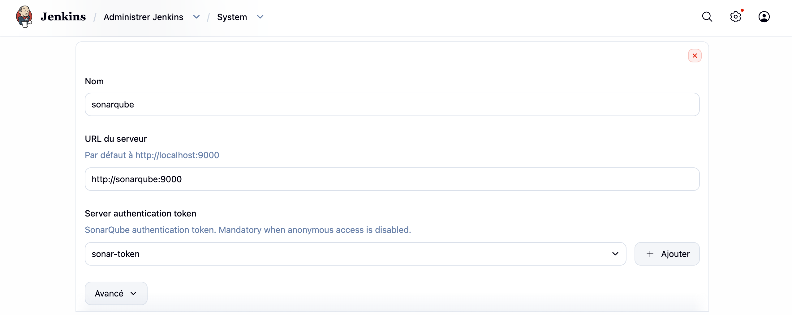
*Figure 8 – Déclaration du serveur SonarQube dans Jenkins (`http://sonarqube:9000`, authentification par `sonar-token`).*

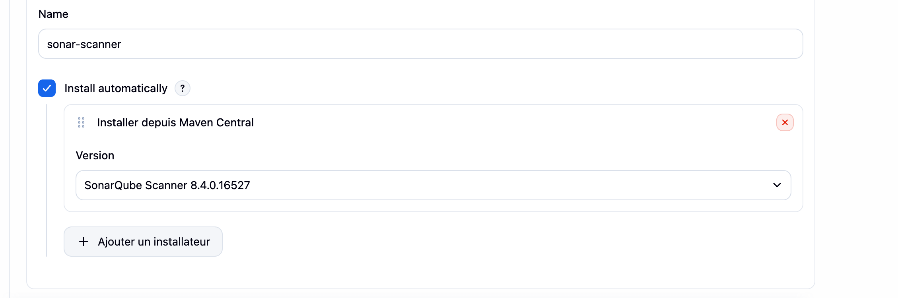
*Figure 9 – Outil `sonar-scanner` installé automatiquement par Jenkins (SonarQube Scanner 8.4.0.16527).*

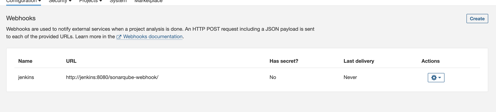
*Figure 10 – Webhook SonarQube → Jenkins : transmet le verdict du Quality Gate au stage `waitForQualityGate`.*

### 3.5 Automatisation de la chaîne CI
[`integration-continue/Jenkinsfile`](../integration-continue/Jenkinsfile) : checkout `Dev` → `npm ci` → `prisma generate` → tests + couverture → analyse SonarQube → Quality Gate → build Docker → scan Trivy → publication Docker Hub.
- Déclenchement automatique par `pollSCM` (toutes les 2 min) : un webhook GitHub ne peut pas atteindre un Jenkins local.
- La publication n'a lieu que si **tous** les contrôles réussissent.

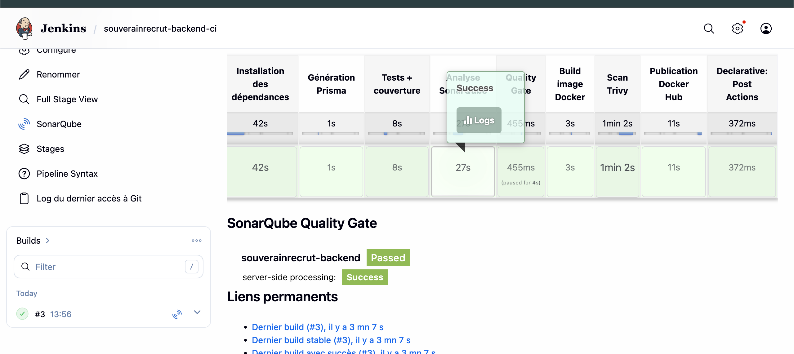
*Figure 11 – Build #3 : tous les stages au vert, Quality Gate SonarQube Passed reçu par webhook, puis publication sur Docker Hub.*

### 3.6 Image Docker et publication

| | Dockerfile fourni | Dockerfile retenu |
|---|---|---|
| Base | `node:20-alpine` (le projet exige Node ≥ 22) | `node:22-alpine` |
| Étapes | 2 | 3 : build, dépendances de production, exécution |
| Utilisateur | `root` | `node` (non-root) |
| Contexte de build | tout le dossier, sans `.dockerignore` | `.dockerignore` : `.env`, `.git`, `node_modules`, tests exclus |
| Santé | aucune | `HEALTHCHECK` sur `/v1/health` |
| Port | `EXPOSE 4000`, application sur 4500 par défaut | `PORT=4000` aligné |
| Outils inutiles | npm, yarn, corepack présents | retirés de l'image finale |

**Seuils Trivy** : HIGH et CRITICAL bloquants (`--exit-code 1`). Une exception justifiée et datée (`deepmerge-ts`, CLI Prisma, correctif réservé à Prisma 7) est documentée dans `backend/.trivyignore`. Les autres failles ont été corrigées par la mise à jour de l'image de base, `npm audit fix` et un `override` de `effect`.

**Contenu de l'image publiée : le code, jamais les données**

L'image publiée sur Docker Hub ne contient que l'API Backend. La base de données n'est pas publiée : elle est créée sur le serveur au moment du déploiement (partie 2).

| Élément | Emplacement |
|---|---|
| Code de l'API compilé et dépendances Node | Image `cherifdiallo725/souverainrecrut-backend` (Docker Hub) |
| Structure des tables (schéma et migrations Prisma) | Dans l'image : aucune donnée, uniquement la définition des tables |
| Moteur PostgreSQL | Image officielle `postgres`, publiée par l'équipe PostgreSQL et lancée sur le serveur par Docker Compose |
| Données (candidats, offres, utilisateurs…) | Volume Docker persistant **sur le serveur**, jamais publié |
| Secrets (mot de passe de la base, `JWT_SECRET`) | Variables sécurisées du pipeline, puis fichier `.env` sur le serveur ; jamais dans le dépôt ni dans l'image |

Raisons de ce choix :
- **Sécurité** : une base intégrée à une image publique rendrait les données des candidats téléchargeables par n'importe qui.
- **Immuabilité** : une image est figée et identique partout, alors qu'une base évolue en permanence. Le code (image) et les données (volume) ont donc des cycles de vie séparés.
- **Rollback** : on peut revenir à une image Backend antérieure sans perdre les données, puisque le volume reste en place.

**Tags** : `<version>-<n° build>` (ex. `1.0.0-3`) et `sha-<commit>` (ex. `sha-8d97f20`), uniques à chaque build ; labels OCI `revision` et `version` dans l'image. `latest` n'est pas utilisé.

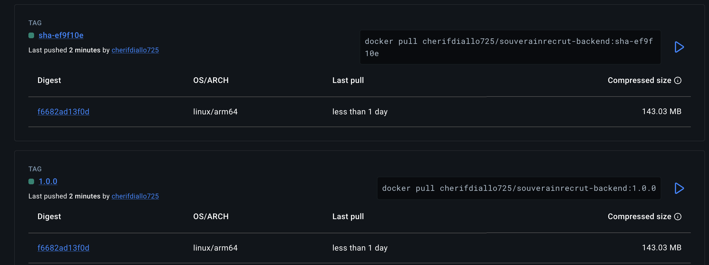
*Figure 12 – Docker Hub : les tags `1.0.0` et `sha-ef9f10e` pointent vers le même digest (`f6682ad13f0d`), donc vers la même image, identifiée à la fois par sa version et par son commit.*

## 4. Résultats

| Indicateur | Avant | Après |
|---|---|---|
| Tests automatisés | 1 (placeholder) | **70** |
| Couverture (SonarQube) | 52,5 % | **94,4 %** |
| Quality Gate | – | **Passed** |
| Vulnérabilités Trivy HIGH + CRITICAL | 46 (dont 2 CRITICAL) | **0 bloquante** |
| Image | Node 20, root, 870 Mo | Node 22, non-root, 143 Mo compressés |
| Publication | manuelle | automatique, conditionnée aux contrôles |

Build Jenkins de référence **#3** : tous les stages verts, images `1.0.0-3` et `sha-8d97f20` publiées. Build **#4** déclenché automatiquement (*SCM change*) après un commit, sans intervention manuelle.

Preuves : [`integration-continue/reports/`](../integration-continue/reports/) et [`integration-continue/captures/`](../integration-continue/captures/).

## 5. Exigences de qualité et de sécurité (section 7 du cahier des charges)

| Exigence | Mise en œuvre |
|---|---|
| Reproductibilité | `npm ci` (lockfile), versions d'outils figées, image Jenkins et pipeline versionnés, procédure dans le README |
| Qualité logicielle | 70 tests à chaque build ; couverture et résultats SonarQube consultables, Quality Gate bloquant |
| Sécurité | Secrets dans les credentials Jenkins, masqués dans les logs ; image non-root analysée par Trivy |
| Traçabilité | Tag `sha-<commit>` et labels OCI reliant l'image au commit |
| Documentation | README du pipeline, rapport, description du Quality Gate, guide de dépannage |


## 6. Limites et pistes d'amélioration

- **Architecture de l'image** : construite sur Apple Silicon, elle est publiée en `linux/arm64` uniquement. Si le serveur de déploiement est en `amd64`, ajouter un build multi-architecture (`docker buildx --platform linux/amd64,linux/arm64`).
- **Exception Trivy** : à lever lors de la migration vers Prisma 7.
- **SonarQube** : base H2 embarquée et version 9.9 (avertissement Node.js) ; en production, base PostgreSQL et version récente.
- **Déclenchement** : `pollSCM` interroge GitHub toutes les 2 minutes ; un webhook (Jenkins exposé publiquement) serait plus réactif.
- **Couverture des branches** : 68 % ; des tests sur la configuration par défaut (`env.ts`) l'amélioreraient.

---

# Partie 2 – Provisionnement et déploiement

## 7. Objectif et contraintes de l'environnement

À l'issue de cette partie, l'API Backend doit être **accessible sur un serveur Ubuntu et communiquer avec PostgreSQL**, déployée par un pipeline GitLab CI/CD à partir de l'image publiée par Jenkins (cahier des charges, sections 4 et 5).

Le travail a été réalisé sur un **Mac Apple Silicon (M1, 8 Go de RAM)**, sans serveur ni VPS. Cette contrainte a orienté trois choix :

| Contrainte | Conséquence | Choix retenu |
|---|---|---|
| ESXi et VMware Workstation n'existent que pour processeurs x86 | Le provider Terraform vSphere est inutilisable | VM créée manuellement, Terraform appliqué aux ressources disponibles (cas prévu au 4.2) |
| VMware Fusion 25H2 et 26H1u1 plantent au démarrage sur macOS 27 (« unrecoverable error », journaux conservés) | Pas d'hyperviseur VMware utilisable | VM créée avec **UTM**, hyperviseur natif Apple Silicon |
| La VM est sur un réseau privé (`192.168.64.0/24`) propre au Mac | Les runners partagés de gitlab.com ne peuvent pas s'y connecter en SSH | **Runner GitLab enregistré sur le Mac**, sur le même réseau que la VM, sans exposer la VM sur Internet |

L'image Backend est publiée en `linux/arm64` ; la VM étant aussi en ARM64 (`aarch64`), elle est utilisée sans reconstruction.

## 8. Architecture de déploiement

```
GitHub (Dev) ─▶ Jenkins ─▶ Docker Hub : cherifdiallo725/souverainrecrut-backend:sha-<commit>
                                   │  docker pull (token en lecture seule)
GitLab (projet privé)              ▼
  pipeline ─▶ runner (Mac) ──SSH──▶ VM Ubuntu 24.04 ARM64 (UTM, 192.168.64.2)
                                     ├── /opt/souverainrecrut/staging  : backend :4001 + PostgreSQL
                                     └── /opt/souverainrecrut/prod     : backend :4000 + PostgreSQL
```

| Étape | Outil | Fichiers |
|---|---|---|
| Serveur | UTM, Ubuntu Server 24.04 | création manuelle |
| Description de l'infrastructure | Terraform | [`deploiement/terraform/`](../deploiement/terraform/) |
| Configuration du serveur | Ansible | [`deploiement/ansible/`](../deploiement/ansible/) |
| Orchestration applicative | Docker Compose | [`deploiement/deployment/`](../deploiement/deployment/) |
| Déploiement | GitLab CI/CD + scripts | [`deploiement/.gitlab-ci.yml`](../deploiement/.gitlab-ci.yml), [`deploiement/scripts/`](../deploiement/scripts/) |

## 9. Travaux réalisés

### 9.1 Préparation de la VM (4.1)

| Ressource | Demandé | Obtenu |
|---|---|---|
| Système | Ubuntu Server 24.04 LTS | Ubuntu 24.04.5 LTS, `aarch64` |
| Processeur | 2 vCPU minimum | 4 vCPU |
| Mémoire | 4 Go minimum | 3,8 Go utilisables |
| Stockage | 30 Go minimum | 29 Go (17 Go libres) |
| Réseau | NAT ou Bridged, accès Internet | *Shared Network* UTM (NAT) |
| Administration | SSH activé et vérifié | OpenSSH, connexion **par clé uniquement** depuis le Mac |

- Accès SSH par une **clé ED25519 dédiée au déploiement** (`~/.ssh/souverainrecrut_deploy`), distincte de toute clé personnelle. Après une exposition accidentelle, cette clé a été remplacée (rotation) et l'ancienne retirée de `authorized_keys`.
- **Snapshot** : UTM ne propose pas de snapshot à chaud comme VMware ; l'équivalent est un **clone de la VM éteinte** (`ubuntu-cicd 2`), copie complète du disque et de la configuration. Il a été réalisé **après** le déploiement et le test du rollback, et non avant la configuration comme le prévoit le cahier des charges : il constitue un point de restauration de l'état validé (Docker installé, staging et production déployés). Le clone reste éteint pour éviter un conflit d'adresse IP avec la VM d'origine.

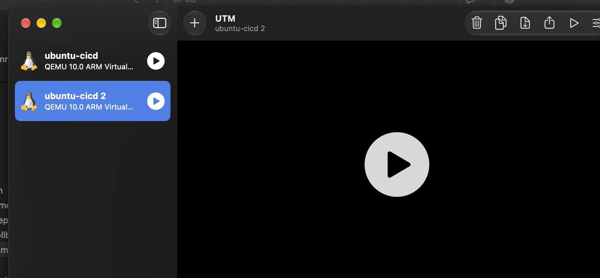
*Figure 13 bis – UTM : la VM de déploiement `ubuntu-cicd` et son clone de sauvegarde `ubuntu-cicd 2`.*

### 9.2 Terraform (4.2)

Le provider vSphere étant inutilisable sans ESXi, Terraform gère les ressources réellement disponibles :

| Ressource | Rôle |
|---|---|
| `terraform_data.ssh_check` | Vérifie que la VM est joignable en SSH **par clé** (`BatchMode`) avant toute configuration |
| `local_file.ansible_inventory` | Génère l'inventaire Ansible à partir des variables : **pont Terraform → Ansible** |

Fichiers : `providers.tf`, `variables.tf` (IP validée par expression régulière), `main.tf`, `outputs.tf`. Les valeurs locales sont dans `terraform.tfvars`, **exclu de Git** ; la clé privée n'est jamais lue par Terraform (seul son chemin est transmis), elle n'apparaît donc pas dans le *state*.

```
$ terraform plan
Plan: 2 to add, 0 to change, 0 to destroy.

$ terraform apply
terraform_data.ssh_check (local-exec): SSH OK : usercicd-QEMU-Virtual-Machine – aarch64 – Ubuntu 24.04.5 LTS
Apply complete! Resources: 2 added, 0 changed, 0 destroyed.

Outputs:
api_urls = {
  "prod"    = "http://192.168.64.2:4000/v1/health"
  "staging" = "http://192.168.64.2:4001/v1/health"
}
server_ip   = "192.168.64.2"
ssh_command = "ssh -i ~/.ssh/souverainrecrut_deploy usercicd@192.168.64.2"
```

### 9.3 Ansible (4.3)

[`playbook.yml`](../deploiement/ansible/playbook.yml), exécuté avec `ansible-playbook playbook.yml -K` :

| Consigne | Tâches |
|---|---|
| Mettre à jour le système et installer les dépendances | `apt update` + `upgrade`, `ca-certificates`, `curl`, `gnupg` |
| Installer Docker Engine et le plugin Compose | dépôt officiel Docker (clé GPG vérifiée, architecture détectée), `docker-ce`, `docker-compose-plugin` |
| Activer et démarrer Docker | `systemctl enable --now docker` |
| Créer le répertoire de déploiement | `/opt/souverainrecrut/staging` et `/opt/souverainrecrut/prod` (propriétaire `usercicd`, droits `0750`) |
| Vérifier le fonctionnement | `docker version`, `docker compose version`, conteneur `hello-world` |

L'utilisateur de déploiement est ajouté au groupe `docker` : le pipeline pilote Docker **sans `sudo`**, aucun mot de passe administrateur n'est stocké dans GitLab.

| Exécution | Résultat | Signification |
|---|---|---|
| 1re | `ok=13 changed=7 failed=0` | Serveur configuré : Docker 29.9.3, Compose 5.7.0, conteneur de test OK |
| 2e | `ok=13 changed=0 failed=0` | **Idempotence** : relancer le playbook ne modifie rien |

Sorties complètes : [`deploiement/reports/`](../deploiement/reports/).

### 9.4 Projet GitLab et secrets (4.4)

- **Projet privé** `souverainrecrut-deploy` : il exécute le déploiement ; le code est identique à celui du dépôt GitHub (livrable public), poussé sur un second *remote*. Le fichier de pipeline est `deploiement/.gitlab-ci.yml` (chemin configuré dans le projet).
- **Variables CI/CD** : stockées dans le projet privé, jamais dans le dépôt. Elles ne sont pas restreintes aux branches protégées (option *Protected* désactivée) afin d'être disponibles sur la branche de travail `Dev`.
- **Runner** `mac-cherif-utm` (exécuteur *shell*, tag `souverainrecrut-mac`) : voir la justification en section 7.

| Variable | Type | Portée | Visibilité | Usage |
|---|---|---|---|---|
| `DEPLOY_HOST`, `DEPLOY_USER` | Variable | tous environnements | visible | adresse et utilisateur SSH du serveur |
| `DEPLOY_USER_PASSWORD` | Variable | tous environnements | visible | mot de passe de l'utilisateur, ajouté lors du dépannage de la connexion SSH sur suggestion du formateur ; **non utilisé par les scripts**, l'authentification se fait par clé |
| `SSH_PRIVATE_KEY` | File | tous environnements | non affichée par les scripts | clé privée de déploiement |
| `SSH_KNOWN_HOSTS` | File | tous environnements | – | clé publique du serveur (non secrète) |
| `DOCKERHUB_USER` | Variable | tous environnements | masquée | compte Docker Hub |
| `DOCKERHUB_TOKEN` | Variable | tous environnements | masquée | token Docker Hub **en lecture seule** |
| `POSTGRES_PASSWORD`, `JWT_SECRET` | Variable | **`staging`** | masquées | secrets du staging |
| `POSTGRES_PASSWORD`, `JWT_SECRET` | Variable | **`production`** | masquées | secrets de la production, distincts du staging |

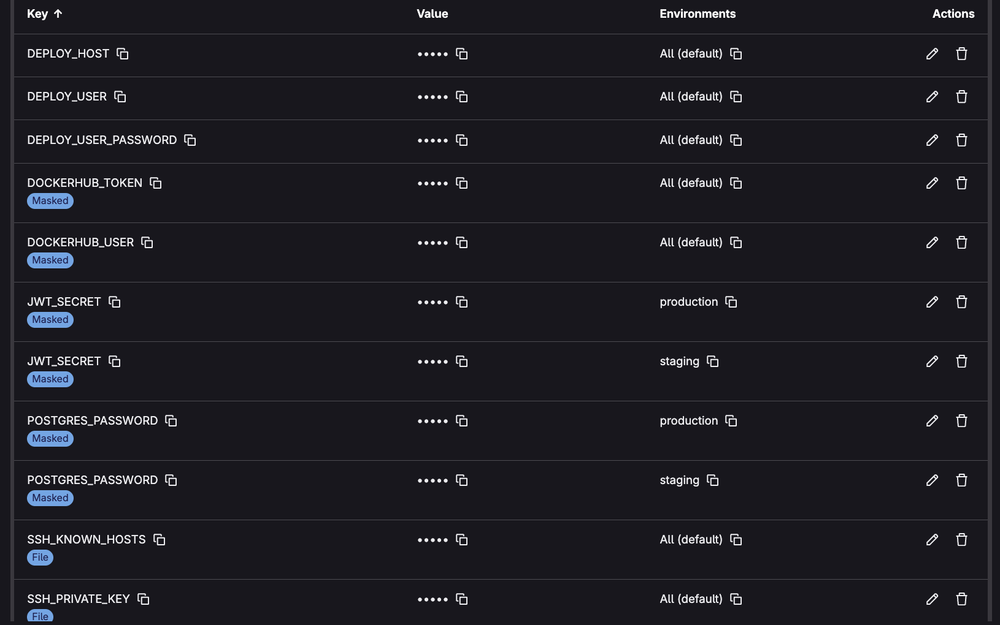
*Figure 13 – Variables CI/CD du projet GitLab : valeurs masquées, secrets de la base et du JWT portés par environnement (`staging`, `production`), clé SSH et empreinte du serveur en type File.*

Le même nom de variable avec une portée par environnement applique le principe « une même image, une configuration par environnement ». L'identité du serveur est vérifiée à chaque connexion (`StrictHostKeyChecking=yes` avec `SSH_KNOWN_HOSTS`).

### 9.5 Récupération de l'image et Docker Compose (5.1, 5.2)

Le serveur **ne reconstruit jamais l'image** : il la télécharge depuis Docker Hub par son tag (`docker compose pull`).

[`docker-compose.yml`](../deploiement/deployment/docker-compose.yml) — un seul fichier pour tous les environnements, seules les valeurs du `.env` changent :

| Consigne du 5.2 | Mise en œuvre |
|---|---|
| Image versionnée de Docker Hub | `image: ${BACKEND_IMAGE}:${IMAGE_TAG}`, aucune directive `build` |
| Variables de l'API et de Prisma | `DATABASE_URL`, `JWT_SECRET`, `PORT`, `NODE_ENV`… depuis `.env` (modèle : [`.env.example`](../deploiement/deployment/.env.example)) |
| Volume persistant, réseau adapté | volume `pgdata` ; réseau `backend` ; **PostgreSQL ne publie aucun port** |
| Redémarrage et contrôles de santé | `restart: unless-stopped` ; `pg_isready` et `/v1/health` |
| Migrations Prisma maîtrisées | service ponctuel `migrate` (`prisma migrate deploy`) lancé **après** que PostgreSQL est sain et **avant** l'API ; si la migration échoue, l'API ne démarre pas |

Premier déploiement manuel en staging (validation avant automatisation) :

```
$ docker compose ps -a
souverainrecrut-staging-backend-1    …:sha-c1e56f9   Up (healthy)    0.0.0.0:4001->4000/tcp
souverainrecrut-staging-migrate-1    …:sha-c1e56f9   Exited (0)
souverainrecrut-staging-postgres-1   postgres:16-alpine   Up (healthy)   5432/tcp

$ docker compose logs migrate
All migrations have been successfully applied.

$ curl http://192.168.64.2:4001/v1/ready
{"success":true,"data":{"status":"READY","database":"CONNECTED", …}}
```

Tables créées par la migration : `users`, `candidates`, `jobs`, `applications` (+ `_prisma_migrations`).

### 9.6 Pipeline de déploiement GitLab CI/CD (5.3)

```
validate-image ─▶ deploy-staging ─▶ smoke-staging ─▶ [ ▶ deploy-prod ] ─▶ smoke-prod
                                     échec : rollback auto   (manuel)       échec : rollback auto
                                                          rollback-prod (manuel)
```

| Job | Rôle |
|---|---|
| `validate-image` | Vérifie le format du tag (`sha-xxxxxxx` ou `X.Y.Z[-N]`, `latest` refusé) et **sa présence sur Docker Hub** |
| `deploy-staging` | Connexion SSH, copie du Compose, génération du `.env`, `docker login` (lecture seule), `pull`, `up -d`, `docker logout` |
| `smoke-staging` | 5 tests de fumée ; en cas d'échec, retour automatique à la version précédente |
| `deploy-prod` | **Approbation manuelle** : le pipeline reste bloqué jusqu'à la validation |
| `smoke-prod` | Mêmes tests en production, avec rollback automatique |
| `rollback-prod` | Retour arrière manuel de la production |

Le tag à déployer est saisi au lancement (input `image_tag`). Les secrets sont transmis au serveur **par l'entrée standard de SSH** : ils n'apparaissent ni dans les logs ni dans la liste des processus. Chaque déploiement est journalisé sur le serveur (`/opt/souverainrecrut/deploy-history.log`).

**Contrôle : une image non publiée par Jenkins est refusée.** Un pipeline lancé sur un commit dont l'image n'existe pas sur Docker Hub s'arrête à la validation, sans rien déployer.

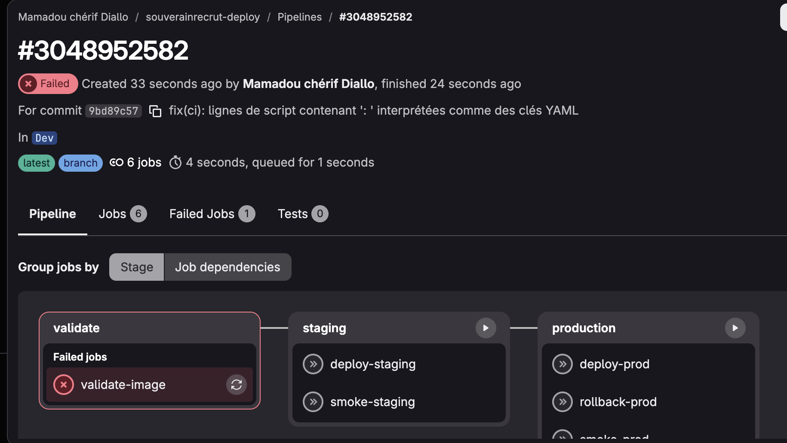
*Figure 14 – Pipeline déclenché par un push : `validate-image` échoue, les étapes de déploiement ne s'exécutent pas.*

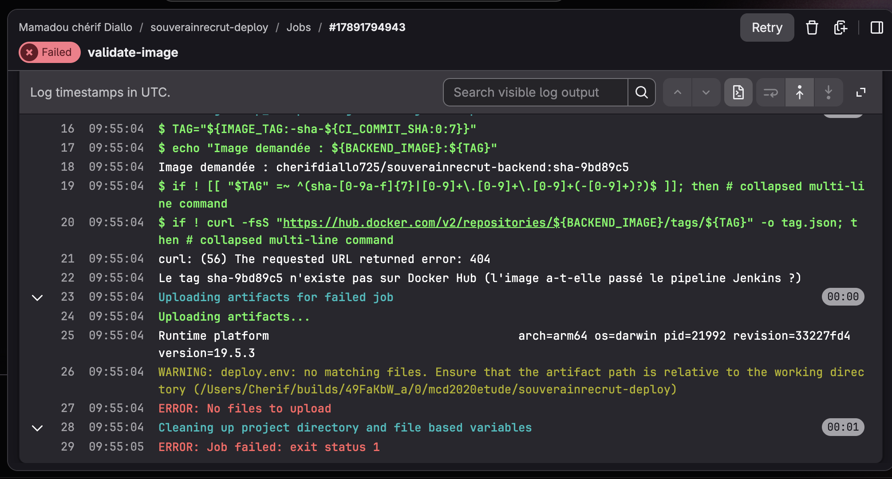
*Figure 15 – Docker Hub répond 404 pour `sha-9bd89c5` : l'image n'a pas passé la chaîne Jenkins, le déploiement est refusé.*

**Approbation manuelle avant la production.** Après un staging validé, le pipeline attend une action humaine.

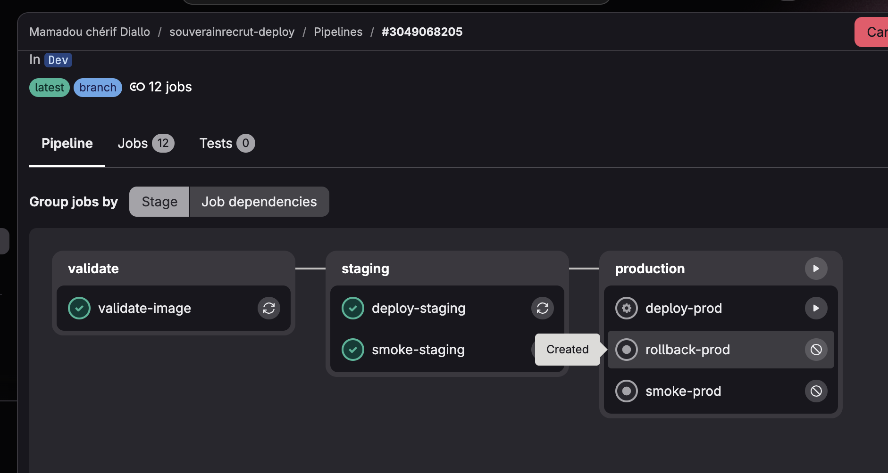
*Figure 16 – Staging déployé et testé ; `deploy-prod` attend l'approbation (bouton ▶).*

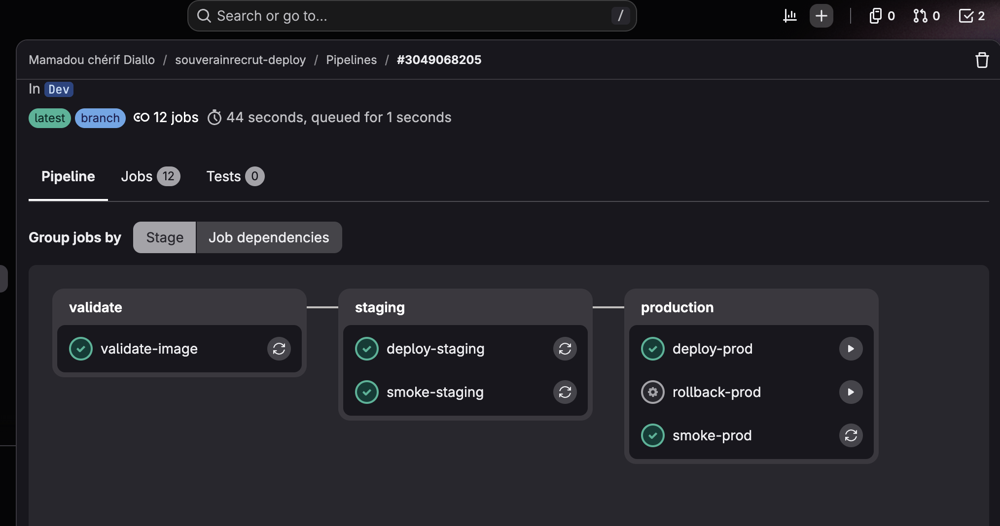
*Figure 17 – Pipeline complet : validation, staging, tests, production approuvée et tests de production au vert. `rollback-prod` reste disponible.*

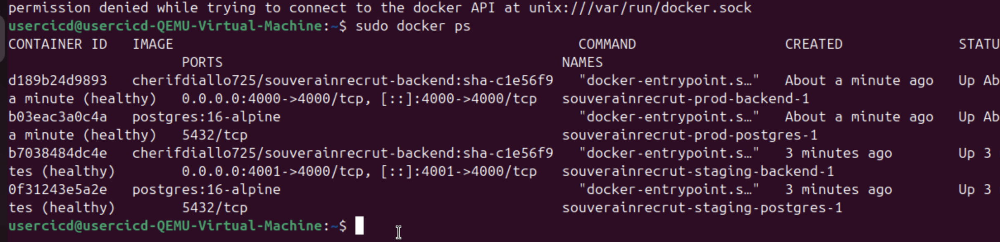
*Figure 18 – Sur la VM : les conteneurs staging (port 4001) et production (port 4000), tous `healthy`, avec la même image `sha-c1e56f9`.*

**Isolation des environnements** (vérifiée sur la VM) :

| | Staging | Production |
|---|---|---|
| Port de l'API | 4001 — `READY` / `CONNECTED` | 4000 — `READY` / `CONNECTED` |
| Image | `sha-c1e56f9` | `sha-c1e56f9` (celle testée en staging) |
| Volume PostgreSQL | `souverainrecrut-staging_pgdata` | `souverainrecrut-prod_pgdata` |
| Réseau Docker | `souverainrecrut-staging_backend` | `souverainrecrut-prod_backend` |
| Secrets | jeu `staging` | jeu `production` (distinct) |

**Trace d'audit** (`deploy-history.log`) :

```
2026-11-10T10:54:39Z env=staging action=deploy tag=sha-c1e56f9 precedent=sha-c1e56f9 par=mcd2020etude pipeline=…/pipelines/3049068205
2026-11-10T10:56:27Z env=prod    action=deploy tag=sha-c1e56f9 precedent=aucun       par=mcd2020etude pipeline=…/pipelines/3049068205
```

Les deux environnements partagent une même VM faute de ressources (8 Go de RAM) ; en production réelle, ils seraient sur deux serveurs : il suffirait d'ajouter un hôte à l'inventaire et de donner une portée par environnement à `DEPLOY_HOST`.

### 9.7 Vérification et rollback (5.4)

**Vérification de l'API et de la base.** Les tests de fumée ([`smoke-test.sh`](../deploiement/scripts/smoke-test.sh)) contrôlent à chaque déploiement :

```
==> Tests de fumée staging : http://192.168.64.2:4001/v1
    OK   API démarrée (/health -> 200)
    OK   Base de données connectée (/ready -> 200)
    OK   Informations de l'API (/info -> 200)
    OK   Route protégée sans token (/candidates -> 401)
    OK   Route inconnue (/route-inconnue -> 404)
==> staging validé
```

**Endpoints métier et persistance.** Le script [`donnees-test.sh`](../deploiement/scripts/donnees-test.sh) crée un compte administrateur de test, s'authentifie (`/auth/login`, JWT), crée un candidat via l'API puis le relit :

```
==> [staging] Connexion OK, création d'un candidat via l'API
    candidat créé (HTTP 201)
==> [staging] Vérification des données
    version déployée : sha-c1e56f9
    authentification : OK
    candidats en base : 1
    OK : le candidat de test est présent
```

**Procédure de rollback.** [`rollback.sh`](../deploiement/scripts/rollback.sh) remplace uniquement `IMAGE_TAG` dans le `.env` du serveur et relance le service `backend` : les secrets et le volume PostgreSQL restent en place, les données sont conservées. La version précédente est mémorisée automatiquement à chaque déploiement (`.previous_tag`) ; un tag précis peut aussi être indiqué. Le rollback est déclenché automatiquement si les tests de fumée échouent, ou manuellement via le job `rollback-prod`.

> Le rollback applicatif n'annule pas les migrations de schéma déjà appliquées. Les migrations doivent donc rester compatibles avec la version précédente (ajouts de colonnes ou de tables plutôt que suppressions ou renommages), comme le rappelle le cahier des charges.

**Test du rollback sur un scénario maîtrisé.** Deux builds Jenkins successifs servent de versions : `sha-8d97f20` (build #3, « v1 ») et `sha-c1e56f9` (build #7, « v2 »).

| Étape | Action | Résultat attendu | Résultat obtenu |
|---|---|---|---|
| 1 | Pipeline avec `image_tag = sha-8d97f20` (v1) | prod en `sha-8d97f20` | ✅ déployée à 11:20:52, pipeline #3049309029 |
| 2 | `donnees-test.sh prod create` | candidat créé | ✅ HTTP 201, 1 candidat en base |
| 3 | Pipeline avec `image_tag = sha-c1e56f9` (v2) | log : `Version actuelle : sha-8d97f20` | ✅ v1 mémorisée ; mise en production approuvée par `mcd2020etude` (figure 19) |
| 4 | Job `rollback-prod` | log : `Rollback prod : sha-c1e56f9 -> sha-8d97f20` | ✅ seuls `backend` et `migrate` recréés ; PostgreSQL reste en fonctionnement (*Up 29 minutes*) (figures 20 et 21) |
| 5 | `donnees-test.sh prod check` + tests de fumée | version `sha-8d97f20`, candidat présent | ✅ version `sha-8d97f20`, candidat présent, 5 tests de fumée OK |

Au passage, un tag saisi avec une espace finale (`"sha-c1e56f9 "`) a été refusé par `validate-image` avant tout déploiement : la validation protège aussi des erreurs de saisie.

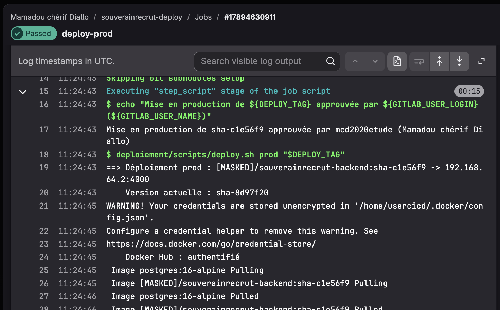
*Figure 19 – Déploiement de la v2 en production : approbation tracée (ligne 17) et version remplacée mémorisée (`Version actuelle : sha-8d97f20`, ligne 20). L'avertissement Docker sur le stockage du token est sans effet durable : le script exécute `docker logout` après le téléchargement.*

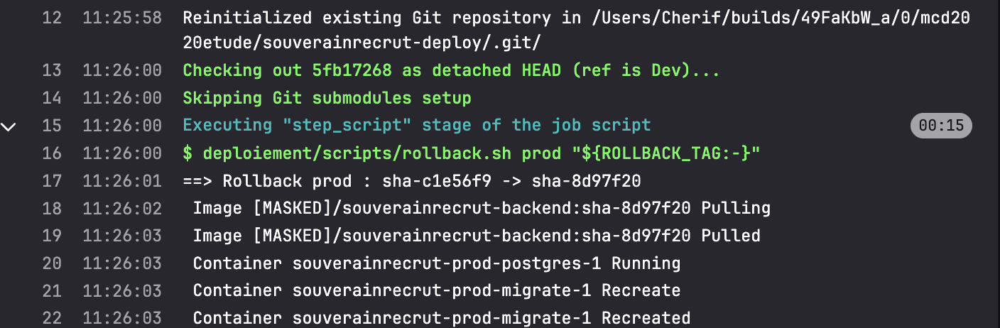
*Figure 20 – Job `rollback-prod` : retour de `sha-c1e56f9` vers `sha-8d97f20`, téléchargement de l'image v1.*

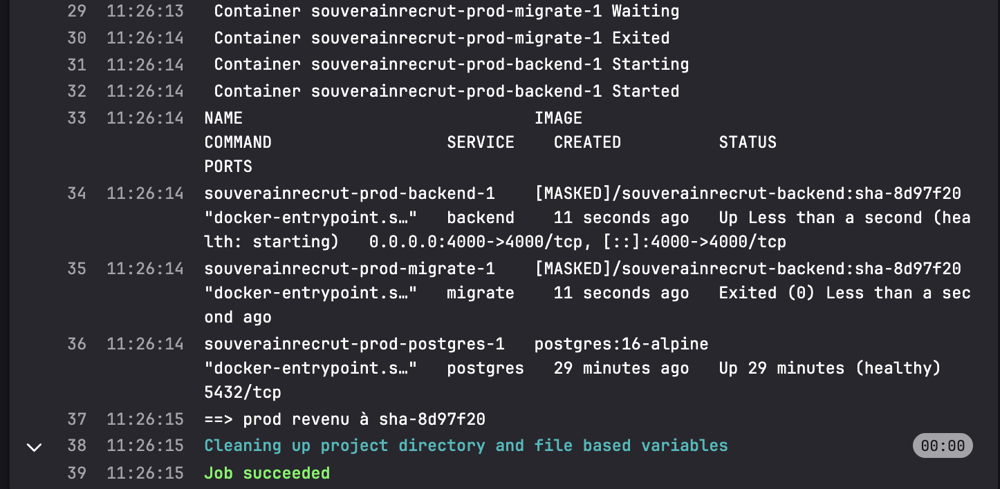
*Figure 21 – Fin du rollback : `backend` en `sha-8d97f20`, migrations rejouées sans erreur (`Exited (0)`), PostgreSQL non redémarré, donc données conservées.*

Résultat de la vérification après rollback :

```
==> [prod] Vérification des données
    version déployée : sha-8d97f20
    authentification : OK
    candidats en base : 1
    OK : le candidat de test est présent
==> Tests de fumée prod : http://192.168.64.2:4000/v1
    OK   API démarrée (/health -> 200)
    OK   Base de données connectée (/ready -> 200)
    OK   Informations de l'API (/info -> 200)
    OK   Route protégée sans token (/candidates -> 401)
    OK   Route inconnue (/route-inconnue -> 404)
==> prod validé
```

Trace d'audit de la séquence (`deploy-history.log`) :

```
2026-11-10T11:20:52Z env=prod action=deploy   tag=sha-8d97f20 precedent=sha-c1e56f9 par=mcd2020etude pipeline=…/pipelines/3049309029
2026-11-10T11:24:58Z env=prod action=deploy   tag=sha-c1e56f9 precedent=sha-8d97f20 par=mcd2020etude pipeline=…/pipelines/3049323619
2026-11-10T11:26:14Z env=prod action=rollback tag=sha-8d97f20 precedent=sha-c1e56f9 par=mcd2020etude pipeline=…/pipelines/3049323619
```

## 10. Exigences de qualité et de sécurité – partie 2

| Exigence | Mise en œuvre |
|---|---|
| Reproductibilité | Terraform, playbook Ansible idempotent, Compose et pipeline versionnés ; l'environnement complet se recrée par commandes |
| Sécurité | Clé SSH dédiée, identité du serveur vérifiée, secrets dans des variables GitLab masquées et protégées, transmis par stdin ; token Docker Hub en lecture seule, déconnecté après usage ; `.env` en `0600` ; PostgreSQL non exposé |
| Traçabilité | Déploiement par tag `sha-<commit>` relié au code et au build Jenkins ; journal d'audit (qui, quand, quelle version, quel pipeline) ; approbation de la production tracée par GitLab |
| Déploiement | Le serveur récupère l'image publiée, applique les migrations et démarre l'API avec PostgreSQL |
| Continuité | Rollback automatique sur échec des tests, rollback manuel de la production, données conservées |

## 11. Limites et pistes d'amélioration – partie 2

- **Terraform** ne crée pas la VM (pas d'ESXi sur Mac ARM) ; avec un hyperviseur compatible, le provider vSphere ou un fournisseur cloud prendrait en charge la création de la machine.
- **Runner sur le poste de développement** : acceptable pour un environnement de formation ; en entreprise, un runner dédié ou un serveur joignable par les runners partagés.
- **Staging et production sur la même VM** : isolés logiquement (réseaux, volumes, ports, secrets) mais pas physiquement.
- **Approbation** : `when: manual` sur l'offre gratuite ; un environnement `production` protégé avec approbateurs désignés (offre Premium) restreindrait la validation à un groupe.
- **Conformité** : génération d'un SBOM (Syft) et signature de l'image (Cosign) avant déploiement, comme présenté en cours.
